# AMG — The Ultimate Pure-HTML Motion Graphics AI Ecosystem
### المنظومة المتكاملة والبيئة الأسمى لإنتاج الموشن جرافيك السينمائي الصافي عبر HTML النقي للذكاء الاصطناعي

[](LICENSE)
[](#)
[](#)
[-purple.svg)](#)
[](#)
[](#)

---

## 🌟 نظرة عامة (Overview)

تم بناء وتطوير مستودع **AMG** ليكون الدستور الهندسي والبيئة الأسمى التي تمكّن أي نموذج ذكاء اصطناعي (Claude, Cursor, Gemini, ChatGPT, Codex...) من إنتاج عروض موشن جرافيك سينمائية فائقة الإتقان باستخدام **HTML فقط (HTML5 + CSS3 + SVG + Canvas + Vanilla JS)**، بدون الحاجة إلى برامج مونتاج ثقيلة (مثل After Effects) وبدون أطر عمل معقدة (No React, No JSX, Zero Dependencies).

يقضي **AMG** على نقاط ضعف وعجز الذكاء الاصطناعي في إنتاج الموشن جرافيك (التداخل البصري، الحركات الخطية الميتة، تشتت التنسيق، انفصال الحروف العربية، التضخم البرمجي، وتزامن الكاميرا العشوائي) عبر **10 مراحل تطورية عملاقة** ونظام **تخطيط مرحلي بملفات معزولة (`planning-with-files`)** وبوابات قفل تأسيسي صارمة (`FOUNDATION_LOCKED`).

---

## 🚀 المراحل التطورية العشر المكتملة (The 10 Evolutionary Phases)

تم تطوير المستودع واختباره وتوثيقه عبر 10 مراحل حاسمة:

| المرحلة | الاسم والوظيفة | المكون الأساسي | أمر الفحص والتحقق |
|---|---|---|---|
| **المرحلة 1** | **حارس الإدراك الفراغي ومنع التصادم** (`Vision Guard`) | `core/amg-vision-guard.js` | `npm run vision-audit` |
| **المرحلة 2** | **محرك فيزياء الحركة وتدرجات الاستوديو** (`Studio Physics`) | `core/amg-studio-physics.js` | `npm run verify-all` |
| **المرحلة 3** | **كاميرا السينما ثلاثية الأبعاد ومنظومة البارالاكس** (`Cinematic 3D Camera`) | `core/amg-cinematic-camera-pro.js` | `npm run verify-all` |
| **المرحلة 4** | **محرك التحول الطوبولوجي وجسور المطابقة** (`Topological Morph`) | `core/amg-morph-bridge.js` | `npm run stage-gate` |
| **المرحلة 5** | **تايبوجرافي الكينيتك العربي والأقنعة الانسيابية** (`Arabic Typography Pro`) | `core/amg-arabic-typography-pro.js` | `npm run stage-gate` |
| **المرحلة 6** | **ترسانة اللقطات السينمائية (150+ وصفة Shotcraft)** | `core/amg-shotcraft-engine.js` | `npm run verify-shotcraft` |
| **المرحلة 7** | **المخططات التحريرية والتشريح الإيزومتري 3D** (`45 Diagrams & Anatomy`) | `core/amg-editorial-diagram-engine.js` | `npm run verify-diagrams` |
| **المرحلة 8** | **استوديو NullMotion Pro ومسجل WebCodecs** (تسجيل 60fps داخلي) | `core/amg-nullmotion-hud-pro.js` | `npm run verify-studio` |
| **المرحلة 9** | **درع Ponytail لمكافحة التضخم وضغط الشفرة** (`Anti-Bloat Guard`) | `core/amg-ponytail-optimizer.js` | `npm run ponytail-audit` |
| **المرحلة 10** | **خط إنتاج الوكلاء الذاتيين والناقد المستقل** (`Multi-Agent Pipeline`) | `scripts/amg-critic.mjs` | `npm run critic` |
| **المرحلة الشاملة** | **البوابة المركزية التفاعلية ومحور الأوامر الشامل** (`Grand Synthesis Hub`) | `index.html` + `scripts/amg-cli.mjs` | `npm run grand-verify` |

---

## 🤖 خط إنتاج الوكلاء الذاتيين الخمسة (`.amg-agents/`)

يعمل المستودع بنظام وكلاء متخصصين يضمن الفصل التام بين الأدوار لمنع العشوائية:

1. **المخرج الإبداعي (`01-director.md`):** صياغة الرؤية المركزية، الاستعارات البصرية، ومنحنى الطاقة السردية.
2. **المهندس المعماري (`02-architect.md`):** تفكيك القصة إلى لقطات Shotcraft وتصميم مسار التحول المستمر.
3. **الرسام ومصمم اللوحات (`03-draftsman.md`):** تجهيز المتجهات والأيقونات والمخططات كلوحات فنية ثابتة (Styleframes) بدون حركة.
4. **محرك التحريك السينمائي (`04-animator.md`):** بث الروح والحركة عبر منحنيات Anime.js v4 وفيزياء الاستوديو وزوايا الكاميرا.
5. **الناقد المستقل الصارم (`05-critic.md`):** الفحص الآلي المستقل لـ 5 محاور وإصدار تقرير القبول أو الرفض.

---

## 🏛️ دمج المشاريع الـ 14 مفتوحة المصدر (The 14 Integrated OSS Projects)

يجمع المستودع خلاصة أفضل 14 مشروعاً مفتوح المصدر في العالم ضمن 6 طبقات وظيفية متناسقة:

```mermaid
flowchart TD
    subgraph L1["1. طبقة العقل والتخطيط والانضباط"]
        PW["OthmanAdi/planning-with-files\n(إدارة الحالة وبوابات المراحل الـ 7)"]
        PN["DietrichGebert/ponytail\n(سلم الاختصار ومنع التعقيد البرمجي)"]
    end

    subgraph L2["2. طبقة الإخراج والمسودات السينمائية"]
        SC["Vincentwei1021/video-shotcraft\n(150+ بطاقة لقطة سينمائية محولة لـ HTML)"]
        NM["blixvip/NullMotion\n(المسودات الهيكلية HyperFrames وشاشة المقارنة المزدوجة)"]
    end

    subgraph L3["3. طبقة مهارات التحريك والفيزياء"]
        MS["iart-ai/motion-skills\n(50+ مهارة حركية وقوانين الفيزياء البصرية)"]
        MG["charlie947/motion-graphics-skills\n(بروتوكول التحكم الزمني window.seek وقوالب Vox/Apple)"]
    end

    subgraph L4["4. طبقة الهندسة والمخططات والـ 3D"]
        DD["cathrynlavery/diagram-design\n(45 مخططاً تحريرياً جاهزاً للتحريك)"]
        AN["wheresryan22/anatomy\n(التشريح الإيزومتري 3D وتفكيك الطبقات)"]
        ST["vercel/satori\n(تحويل بطاقات Flexbox إلى مسارات SVG ذرية)"]
    end

    subgraph L5["5. طبقة محركات التشغيل (Pure-HTML)"]
        AJ["juliangarnier/anime v4\n(Timeline, createDrawable, morphTo, Spring)"]
        D3["d3/d3 v7\n(Scales, Shapes, Interpolators, Layouts)"]
    end

    subgraph L6["6. خزينة الأيقونات المتجهة"]
        SI["simple-icons (3000+ شعار تقني)"]
        LU["lucide (أيقونات هندسية نظيفة)"]
        TB["tabler-icons (5000+ أيقونة تخصصية)"]
    end

    L1 --> L2 --> L3 --> L4 --> L5 --> L6
```



---

## 🎨 صالات العرض التفاعلية والمعاينة المباشرة (Galleries & Demos)

يمكن فتح وتشغيل جميع المعارض بنقرة مزدوجة في أي متصفح (Zero CORS / Standalone) أو عبر سيرفر المعاينة المحلي:

* **صالة عرض Shotcraft التفاعلية (150+ لقطة):**  
  `vault/shotcraft-cards/shotcraft-gallery.html`
* **صالة عرض المخططات والتشريح الإيزومتري (45 مخططاً):**  
  `vault/techniques/05-editorial-diagrams-45/diagram-gallery.html`
* **عرض الإصدار الرئيسي المكتمل (Flagship Master Release):**  
  `workspace/amg-flagship-showcase/stage-07-master/master_release.html`
* **استوديو فحص الأيقونات المتجهة:**  
  `vault/icons/index.html`

لتشغيل خادم المعاينة السريع:
```bash
npm start
# يفتح السيرفر على http://localhost:3000
```

---

## 🛠️ أوامر الفحص والتحقق وضمان الجودة (CLI & QA Commands)

تم تزويد المستودع بترسانة أوامر فحص شاملة:

```bash
# 1. تشغيل الفحص الشامل الموحد للمنظومة التتويجية (30/30 اختباراً بنسبة 100%)
npm run grand-verify

# 2. تشغيل محور سطر الأوامر الموحد AMG CLI
node scripts/amg-cli.mjs help

# 3. تشغيل كافة اختبارات التحقق الأساسية دفعة واحدة
npm run verify-all

# تقييم المشروع بواسطة الناقد المستقل وإصدار تقرير critic_report.md
npm run critic amg-flagship-showcase

# فحص كفاءة وصفات اللقطات السينمائية (Shotcraft)
npm run verify-shotcraft

# فحص محرك المخططات والتشريح الإيزومتري (45 Diagrams & Anatomy)
npm run verify-diagrams

# فحص استوديو NullMotion Pro ومسجل WebCodecs
npm run verify-studio

# فحص كفاءة درع مكافحة التضخم البرمجي Ponytail
npm run verify-ponytail

# تدقيق الإدراك الفراغي والتباين في مجلدات المشاريع
npm run vision-audit workspace/amg-flagship-showcase/

# فحص عمق DOM ومنع التضخم (أقصى عمق <= 5)
npm run ponytail-audit workspace/amg-flagship-showcase/
```

---

## 🔄 بروتوكول المراحل السبع المعزولة (The 7 Hard-Isolated Stages)

يُمنع أي AI من القفز بين المراحل أو كتابة التحريك قبل اكتمال اللوحة الثابتة:

1. **المرحلة 1: الرؤية الإبداعية والمسار (`stage-01-vision`):** صياغة الاستعارة البصرية المركزية (Visual Metaphor)، منحنى الطاقة (Pacing Curve)، واختيار المسار والألوان.
2. **المرحلة 2: الإخراج وبطاقات اللقطات (`stage-02-shotcraft`):** اختيار وصفات اللقطات من الـ 150 لقطة وتصميم سلسلة التحول المتصل (Continuous Morph Chain).
3. **المرحلة 3: الذخيرة البصرية (`stage-03-arsenal`):** تجهيز الأيقونات ومخططات SVG وبطاقات Satori المفحوصة.
4. **المرحلة 4: المسودة الزمنية (`stage-04-animatic`):** بناء مسودة أبيض وأسود (NullMotion HyperFrames) لاختبار التوقيت والكاميرا مع `window.seek(t)`.
5. **المرحلة 5: اللوحات التصميمية الثابتة (`stage-05-styleframes`):** **صفر كود تحريك!** بناء المشهد كلوحة فنية ثابتة وفحص عدم وجود تداخل نصي.
6. **المرحلة 6: التحريك الدقيق مشهداً بمشهد (`stage-06-motion-scenes`):** تحريك كل مشهد على حدة باستخدام `Anime.js v4` و`D3` مع تسجيل لقطة خروج الحالة (`exitStateSnapshot`).
7. **المرحلة 7: التجميع والمراجعة والتصدير (`stage-07-master`):** دمج المشاهد في ملف مستقل 100% ومراجعتها في استوديو NullMotion وتصدير MP4 عبر WebCodecs.

---

## 🎨 المسارات الإبداعية السبعة المجهزة مسبقاً (`tracks/`)

1. **`01-editorial-vox-explainer`:** تحقيقات صحفية وشروحات وثائقية بأسلوب Vox و NYT (خلفية ورقية دافئة، تظليل نصي).
2. **`02-flagship-product-launch`:** إعلانات إطلاق منتجات تقنية فاخرة بأسلوب Apple و Linear (إضاءة سينمائية، بطاقات Bento).
3. **`03-isometric-system-anatomy`:** تفكيك هندسي ثلاثي الأبعاد للأنظمة السحابية والآلات (Isometric 3D Exploded Views).
4. **`04-dynamic-data-journalism`:** قصص البيانات والإحصائيات والرسوم البيانية المتحركة بـ D3.
5. **`05-kinetic-typography-reels`:** تايبوجرافي حركي خاطف للفيديوهات الطولية (9:16 Reels/TikTok).
6. **`06-ad-breakdown-hyperframes`:** مختبر تفكيك الإعلانات ودراسة الإيقاع والمقارنة المتزامنة عبر NullMotion.
7. **`07-arabic-editorial-motion`:** موشن جرافيك عربي تحريري أصيل مع حماية اتصال الحروف واتجاه RTL.

---

## 📂 الهيكل المعماري للمستودع (Repository Structure)

```text
AMG/
├── AMG_MASTER_ROUTER.md                   # خريطة التوجيه الذكية الشاملة للذكاء الاصطناعي
├── AGENTS.md                              # دستور الوكلاء وأنظمة الذكاء الاصطناعي في AMG
├── UNIVERSAL_AI_PROMPT.md                 # برومبت التشغيل المباشر لأي AI خارجي
├── .amg-planning/                         # بروتوكولات المراحل الـ 7 وقوالب التخطيط وبوابات القفل
├── .amg-agents/                           # أدوار الوكلاء الذاتيين الخمسة (Director, Architect, Draftsman, Animator, Critic)
├── core/                                  # نواة التشغيل النقية (Pure Vanilla Runtime)
│   ├── amg-vision-guard.js                # حارس الإدراك الفراغي ومنع التصادم البصري
│   ├── amg-studio-physics.js              # محرك الفيزياء وتدرجات الاستوديو (Springs & Easing)
│   ├── amg-cinematic-camera-pro.js        # كاميرا السينما 3D ومنظومة البارالاكس
│   ├── amg-morph-bridge.js                # محرك التحول الطوبولوجي وجسور المطابقة
│   ├── amg-arabic-typography-pro.js       # تايبوجرافي الكينيتك العربي والأقنعة الانسيابية
│   ├── amg-shotcraft-engine.js            # محرك تنفيذ وصفات اللقطات السينمائية الـ 150
│   ├── amg-editorial-diagram-engine.js     # محرك المخططات التحريرية الـ 45
│   ├── amg-isometric-anatomy-pro.js       # محرك التشريح الإيزومتري وتفكيك الطبقات 3D
│   ├── amg-nullmotion-hud-pro.js          # استوديو المعاينة ولوحة التحكم والتحكم بالإطارات
│   ├── amg-webcodecs-recorder.js          # مسجل الفيديو 60fps الداخلي فائق الجودة
│   ├── amg-ponytail-optimizer.js          # درع مكافحة التضخم البرمجي وضغط الشفرة
│   ├── amg-clock.js                       # الساعة الزمنية الحتمية المركزية (window.seek)
│   ├── amg-text-engine.js                 # محرك التايبوجرافي العربي والأقنعة المنزلقة
│   └── vendor/                            # Anime.js v4 ESM و D3.js v7 مدمجة محلياً (Zero CDN)
├── tracks/                                # المسارات الإبداعية الـ 7 المصنفة مسبقاً
├── vault/                                 # خزينة التقنيات واللقطات والمخططات والأيقونات
│   ├── catalog/                           # فهارس JSON الدلالية السريعة للبحث الفوري
│   ├── techniques/                        # كود التقنيات الجاهزة للاستدعاء الفوري (80+ تقنية)
│   │   └── 05-editorial-diagrams-45/      # صالة عرض وكود المخططات الـ 45
│   ├── shotcraft-cards/                   # بطاقات وصالة عرض اللقطات السينمائية (150+ لقطة)
│   └── icons/                             # الأيقونات المتجهة المجهزة للرسم الحركي (Simple, Lucide, Tabler)
├── scripts/                               # أدوات الأتمتة والفحص والناقد المستقل وسطر الأوامر
└── workspace/                             # مساحة المشاريع المنفذة بالمراحل الـ 7
    └── amg-flagship-showcase/             # مشروع استعراضي كامل ومكتمل ومختوم 100%
```

---

## 📜 الترخيص (License)
مرخص تحت رخصة [MIT](LICENSE) — متاح بالكامل للاستخدام التجاري والشخصي وتطوير أدوات الذكاء الاصطناعي وإنتاج الفيديو البرمجي فائق الدقة.
