# AMG — The Ultimate Pure-HTML Motion Graphics AI Ecosystem
### أحدث وأقوى بيئة عمل، ومسار إنتاجي، ومكتبة موارد لأي ذكاء اصطناعي لصناعة الموشن جرافيك بـ HTML النقي فقط

[](LICENSE)
[](#)
[](#)
[-purple.svg)](#)

---

## 🌟 نظرة عامة (Overview)

تم بناء مستودع **AMG** ليكون الدستور الهندسي والبيئة الأسمى التي تمكّن أي نموذج ذكاء اصطناعي (Claude, Cursor, Gemini, ChatGPT, Codex...) من إنتاج عروض موشن جرافيك سينمائية فائقة الإتقان باستخدام **HTML فقط (HTML5 + CSS3 + SVG + Canvas + Vanilla JS)**، بدون الحاجة إلى برامج مونتاج ثقيلة (مثل After Effects) وبدون أطر عمل معقدة (No React, No JSX).

يعالج **AMG** المشكلة الكبرى للذكاء الاصطناعي: **"العمل العشوائي على كل شيء دفعة واحدة"**، ويستبدلها بـ **مسار صارم مقسم إلى 7 مراحل معزولة** مع بوابات قفل تأسيسية (`FOUNDATION_LOCKED`) وموارد مصنفة مسبقاً، ليذهب 100% من تركيز الذكاء الاصطناعي نحو **الإبداع في التخطيط والتكوين البصري والفيزياء الحركية**.

---

## 🏛️ دمج المشاريع الـ 14 مفتوحة المصدر (The 14 Integrated OSS Projects)

يجمع المستودع خلاصة أفضل 14 مشروعاً مفتوح المصدر في العالم ضمن 6 طبقات وظيفية متناسقة:

```mermaid
flowchart TD
    subgraph L1["1. طبقة العقل والتخطيط والانضباط"]
        PW["OthmanAdi/planning-with-files\n(إدارة الحالة وبوابات المراحل الـ 7)"]
        PN["DietrichGebert/ponytail\n(سلم الاختصار ومنع التعقيد البرمجي)"]
    end

    subgraph L2["2. طبقة الإخراج والمسودات السينمائية"]
        SC["Vincentwei1021/video-shotcraft\n(150+ بطاقة لقطة سينمائية محولة لـ HTML)"]
        NM["blixvip/NullMotion\n(المسودات الهيكلية HyperFrames وشاشة المقارنة المزدوجة)"]
    end

    subgraph L3["3. طبقة مهارات التحريك والفيزياء"]
        MS["iart-ai/motion-skills\n(50+ مهارة حركية وقوانين الفيزياء البصرية)"]
        MG["charlie947/motion-graphics-skills\n(بروتوكول التحكم الزمني window.seek وقوالب Vox/Apple)"]
    end

    subgraph L4["4. طبقة الهندسة والمخططات والـ 3D"]
        DD["cathrynlavery/diagram-design\n(45 مخططاً تحريرياً جاهزاً للتحريك)"]
        AN["wheresryan22/anatomy\n(التشريح الإيزومتري 3D وتفكيك الطبقات)"]
        ST["vercel/satori\n(تحويل بطاقات Flexbox إلى مسارات SVG ذرية)"]
    end

    subgraph L5["5. طبقة محركات التشغيل (Pure-HTML)"]
        AJ["juliangarnier/anime v4\n(Timeline, createDrawable, morphTo, Spring)"]
        D3["d3/d3 v7\n(Scales, Shapes, Interpolators, Layouts)"]
    end

    subgraph L6["6. خزينة الأيقونات المتجهة"]
        SI["simple-icons (3000+ شعار تقني)"]
        LU["lucide (أيقونات هندسية نظيفة)"]
        TB["tabler-icons (5000+ أيقونة تخصصية)"]
    end

    L1 --> L2 --> L3 --> L4 --> L5 --> L6
```



---

## 🔄 بروتوكول المراحل السبع المعزولة (The 7 Hard-Isolated Stages)

يُمنع أي AI من القفز بين المراحل أو كتابة التحريك قبل اكتمال اللوحة الثابتة:

1. **المرحلة 1: الرؤية الإبداعية والمسار (`stage-01-vision`):** صياغة الاستعارة البصرية المركزية (Visual Metaphor)، منحنى الطاقة (Pacing Curve)، واختيار المسار والألوان.
2. **المرحلة 2: الإخراج وبطاقات اللقطات (`stage-02-shotcraft`):** اختيار وصفات اللقطات من الـ 150 لقطة وتصميم سلسلة التحول المتصل (Continuous Morph Chain).
3. **المرحلة 3: الذخيرة البصرية (`stage-03-arsenal`):** تجهيز الأيقونات ومخططات SVG وبطاقات Satori المفحوصة.
4. **المرحلة 4: المسودة الزمنية (`stage-04-animatic`):** بناء مسودة أبيض وأسود (NullMotion HyperFrames) لاختبار التوقيت والكاميرا مع `window.seek(t)`.
5. **المرحلة 5: اللوحات التصميمية الثابتة (`stage-05-styleframes`):** **صفر كود تحريك!** بناء المشهد كلوحة فنية ثابتة وفحص عدم وجود تداخل نصي.
6. **المرحلة 6: التحريك الدقيق مشهداً بمشهد (`stage-06-motion-scenes`):** تحريك كل مشهد على حدة باستخدام `Anime.js v4` و`D3` مع تسجيل لقطة خروج الحالة (`exitStateSnapshot`).
7. **المرحلة 7: التجميع والمراجعة والتصدير (`stage-07-master`):** دمج المشاهد في ملف مستقل 100% ومراجعتها في استوديو NullMotion وتصدير MP4.

---

## 🎨 المسارات الإبداعية السبعة المجهزة مسبقاً (`tracks/`)

1. **`01-editorial-vox-explainer`:** تحقيقات صحفية وشروحات وثائقية بأسلوب Vox و NYT (خلفية ورقية دافئة، تظليل نصي).
2. **`02-flagship-product-launch`:** إعلانات إطلاق منتجات تقنية فاخرة بأسلوب Apple و Linear (إضاءة سينمائية، بطاقات Bento).
3. **`03-isometric-system-anatomy`:** تفكيك هندسي ثلاثي الأبعاد للأنظمة السحابية والآلات (Isometric 3D Exploded Views).
4. **`04-dynamic-data-journalism`:** قصص البيانات والإحصائيات والرسوم البيانية المتحركة بـ D3.
5. **`05-kinetic-typography-reels`:** تايبوجرافي حركي خاطف للفيديوهات الطولية (9:16 Reels/TikTok).
6. **`06-ad-breakdown-hyperframes`:** مختبر تفكيك الإعلانات ودراسة الإيقاع والمقارنة المتزامنة عبر NullMotion.
7. **`07-arabic-editorial-motion`:** موشن جرافيك عربي تحريري أصيل مع حماية اتصال الحروف واتجاه RTL.

---

## 🚀 البدء السريع (Quickstart)

### 1. استنساخ المستودع:
```bash
git clone https://github.com/yalaahamdy/AMG.git
cd AMG
```

### 2. بدء مشروع موشن جرافيك جديد:
```bash
node scripts/amg-init.mjs my-awesome-video --track=02-flagship-product-launch --aspect=16:9
```

### 3. البحث الفوري في الخزائن (أيقونات، لقطات، مخططات، تقنيات):
```bash
# بحث عن أيقونة
node scripts/amg-query.mjs icon cloud

# بحث عن بطاقة لقطة سينمائية
node scripts/amg-query.mjs shot slam

# بحث عن مخطط تحريري
node scripts/amg-query.mjs diagram architecture

# بحث عن تقنية حركية جاهزة
node scripts/amg-query.mjs tech morph
```

### 4. فحص بوابة أي مرحلة والتأكد من الانضباط:
```bash
node scripts/amg-stage-gate.mjs my-awesome-video 1
node scripts/amg-stage-gate.mjs my-awesome-video 5
```

### 5. تجميع المشاهد في ملف نهائي مستقل:
```bash
node scripts/amg-bundle-master.mjs my-awesome-video
```

---

## 📂 الهيكل المعماري للمستودع (Repository Structure)

```text
AMG/
├── AMG_MASTER_ROUTER.md                   # خريطة التوجيه الذكية لأي AI
├── AGENTS.md                              # دستور الوكلاء (Planning + Ponytail)
├── UNIVERSAL_AI_PROMPT.md                 # برومبت التشغيل المباشر لأي AI خارجي
├── .amg-planning/                         # بروتوكولات المراحل الـ 7 وقوالب التخطيط
├── core/                                  # نواة التشغيل النقية (Clock, Camera, SVG, Text, HUD)
│   └── vendor/                            # Anime.js v4 ESM و D3.js v7 مدمجة محلياً
├── tracks/                                # المسارات الإبداعية الـ 7 المصنفة مسبقاً
├── vault/                                 # خزينة التقنيات الـ 90+ واللقطات الـ 150 والأيقونات
│   ├── catalog/                           # فهارس JSON الدلالية السريعة
│   ├── techniques/                        # كود التقنيات الجاهزة للاستدعاء الفوري
│   ├── shotcraft-cards/                   # بطاقات اللقطات السينمائية
│   └── icons/                             # الأيقونات المتجهة المجهزة للرسم الحركي
├── scripts/                               # أدوات الأتمتة والفحص وسطر الأوامر
└── workspace/                             # مساحة المشاريع المنفذة بالمراحل الـ 7
    └── amg-flagship-showcase/             # مشروع استعراضي كامل ومكتمل المراحل
```

---

## 📜 الترخيص (License)
مرخص تحت رخصة [MIT](LICENSE) — متاح بالكامل للاستخدام التجاري والشخصي وتطوير أدوات الذكاء الاصطناعي.
